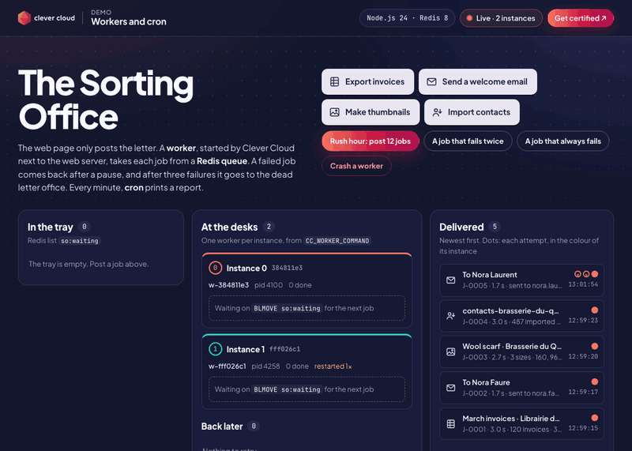
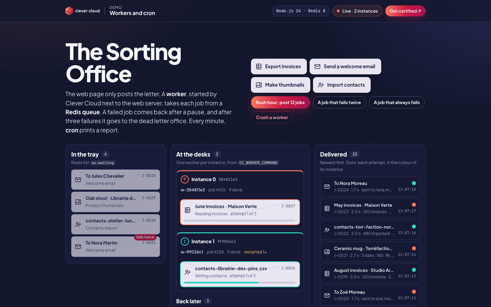
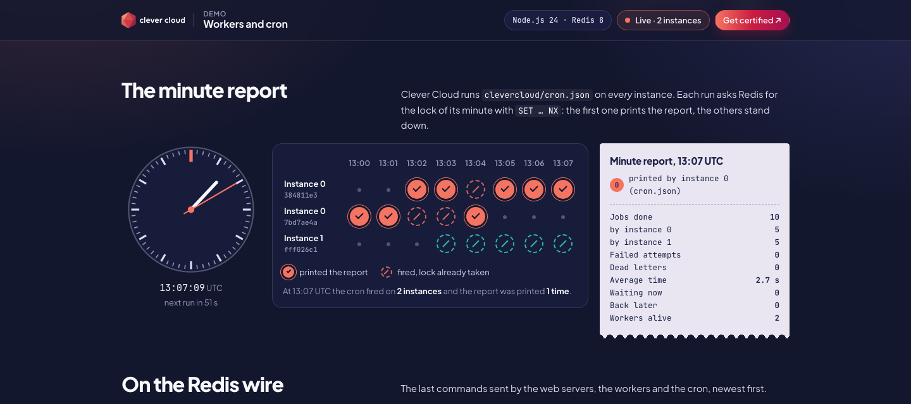
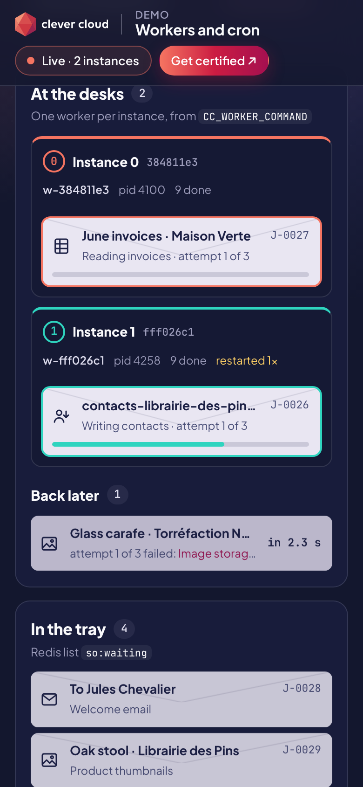
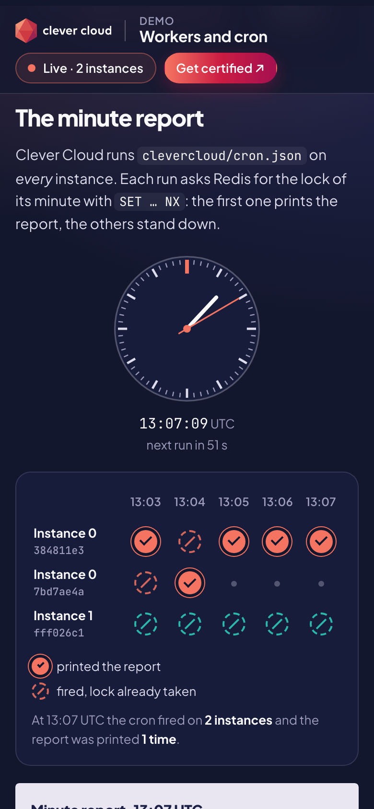

# The Sorting Office — Workers, Redis queue and cron on Clever Cloud

> Exports, emails, thumbnails, imports: every business app has work that must not run inside a web request. In this sorting office the web page only posts the letter to a **Redis list**. A **worker**, started by Clever Cloud next to the web server from one environment variable, takes each job with `BLMOVE`. A failed job comes back after 3 s, then 6 s; after the third failure it lands in the dead letter office. Crash a worker from the page: the platform starts it again within two seconds, and it picks up the job it was holding. Every minute, **`clevercloud/cron.json`** prints a report. Clever Cloud runs that cron on every instance, so a Redis lock (`SET NX`) makes sure only one of them prints it.







| Phone, the floor | Phone, the minute report |
|---|---|
|  |  |

**Run it yourself.** The hosted demo was taken down after the presales review (November 2026). The steps in [Deploy on Clever Cloud](#deploy-on-clever-cloud) recreate it from scratch in about 5 minutes.

**Get certified.** This demo runs on Clever Cloud. To deploy your own apps the same way, get certified at the [Clever Cloud Academy](https://academy.clever.cloud/).

## What Clever Cloud does in the demo

| Where | Clever Cloud feature | What you see |
|---|---|---|
| At the desks | `CC_WORKER_COMMAND="node src/worker.js"`: a background process on every instance, run by systemd next to the web server | One desk per instance. Each worker waits on `BLMOVE so:waiting …` and takes the next job |
| Crash a worker | `CC_WORKER_RESTART` (default `on-failure`): a worker that exits with an error is started again | The worker exits with code 1 in the middle of a job. About 2 s later its desk shows a new pid and "restarted 1×", and the job it held is done (dashed dot: recovered) |
| The minute report | `clevercloud/cron.json` runs `bin/minute-report.sh`, whose `#!/bin/bash -l` loads the app's variables | Every minute, one stamp per instance: one prints the report, the others find the lock taken. The report also lands in `clever logs` (`CMDOUT`) |
| Two instances | Horizontal scaling | A second desk appears about 20 s after `clever scale`. The two workers share the tray, and a retry often runs on the other instance (dots of two colours) |
| Deploy or restart | Zero-downtime deployment | Old and new instances overlap for up to two minutes: up to four stamps for one minute, still one report |
| Redis add-on | `REDIS_URL`, injected into the web server, the workers and the cron | "On the Redis wire" lists the last commands each of them sent |

## What was verified on Clever Cloud

Measured on 4 November 2026, app on nano instances, Redis `s_mono`:

- **The cron runs on every instance**, as the [cron documentation](https://www.clever.cloud/developers/doc/develop/cron/) says. With two instances, every minute had two runs and one report. During the scale-up from 1 to 2 instances, three machines fired at 15:57 and 15:58, **two of them with `INSTANCE_NUMBER=0`** (the old instance and its replacement). During `clever restart`, four machines fired at 16:08 and 16:09. A guard on `INSTANCE_NUMBER` would have printed twice. The Redis lock printed once every time.
- **The worker is restarted by the platform.** It exited with code 1 at 15:55:15.9 and was running again at 15:55:18.1 (`start #2`), with the job it held back at the head of the tray.
- **No job lost** across two `clever restart` in the middle of 24 and 48 jobs: 163 posted, 162 done, 1 dead on purpose.
- **Light load**: 300 `GET /api/state` (10 in parallel) and 60 jobs posted at once. No error, 25 ms median, 46 ms at p95. Two nano workers did the 60 jobs in 84 s, 12 and 13 per instance in the minute report.

## Deploy on Clever Cloud

You need [clever-tools](https://www.clever.cloud/developers/doc/cli/) (`clever login` done) and the ID of the organisation that will own the resources (`orga_…`, shown in the Console). Run the commands from the repo root: `clever create` links the folder to the new app.

```bash
# 1. The app and its size
clever create --type node demo-workers-cron --org <org_id> --region par
clever scale --min-flavor nano --max-flavor XS --min-instances 1 --max-instances 2
clever scale --build-flavor M

# 2. Redis: the smallest dedicated plan, encrypted at rest, linked to the app (injects REDIS_URL)
clever addon create redis-addon demo-workers-cron-redis --plan s_mono --region par --org <org_id> --option encryption=true --link demo-workers-cron --yes

# 3. The worker and the health check
clever env set CC_WORKER_COMMAND "node src/worker.js"
clever env set CC_HEALTH_CHECK_PATH /health

# 4. Deploy: clevercloud/cron.json and bin/minute-report.sh come with the code
clever deploy
clever domain
```

On the first start the app posts one job of each kind, so the board is never empty. The first minute report prints at the next full minute (times are UTC). `bin/minute-report.sh` must stay executable in git (`100755`), as the cron runs it directly.

### Demo in five minutes

1. **Rush hour: post 12 jobs.** The tray fills, the desk works through it, the Redis wire shows each `LPUSH` and `BLMOVE`.
2. **A job that fails twice.** It waits on the "Back later" shelf (3 s, then 6 s) and is delivered on the third attempt: two hollow dots, one full.
3. **A job that always fails.** Three attempts, then the dead letter office. **Requeue** puts it back at the head of the tray.
4. **Crash a worker.** Watch the pid change and "restarted 1×" appear, then the job it held being delivered.
5. **Two instances.** `clever scale --min-instances 2 --max-instances 2`, post a rush again: two desks share the tray. At the next minute, two stamps and one report. Back to normal with `clever scale --min-instances 1 --max-instances 2`.

## Deploying from a monorepo (`APP_FOLDER`)

Tested on 4 November 2026 with the demo in a subfolder of a repo and `APP_FOLDER=demo-workers-cron`:

| Part | What happens | What to set |
|---|---|---|
| Build and web | `npm install` and `npm start` run in the subfolder | Nothing |
| `clevercloud/cron.json` | Not read: the deployment logs say "No cron to setup" | A second worker runs the same report: `CC_WORKER_COMMAND_1="node demo-workers-cron/src/scheduler.js"` |
| `CC_WORKER_COMMAND` | Runs from the repo root: `Cannot find module '/home/bas/app_…/src/worker.js'` in a loop, while the deployment reports success | Prefix the folder: `CC_WORKER_COMMAND="node demo-workers-cron/src/worker.js"` |

`src/scheduler.js` wakes up at second 0 of every minute and takes the same Redis lock, so it is safe on several instances and even next to `cron.json`. Its stamps carry a small "w". The trade-off: a process that runs all the time instead of a crontab line.

## Variables

| Variable | Set by | Role |
|---|---|---|
| `REDIS_URL` | the Redis add-on (linked) | Read by the web server, the workers and the cron |
| `CC_WORKER_COMMAND` | you | `node src/worker.js`: the worker, one per instance |
| `CC_HEALTH_CHECK_PATH` | you | `/health` |
| `CC_WORKER_COMMAND_1` | you, with `APP_FOLDER` only | `node <folder>/src/scheduler.js`: the minute report without `cron.json` |
| `QUEUE_PREFIX` | optional | Prefix of every Redis key, `so:` by default. Lets two apps share one Redis |
| `MAX_ATTEMPTS`, `RETRY_BASE_SECONDS`, `FLAKY_RATE` | optional | `3`, `3` (then doubled) and `0.08` (share of ordinary jobs that hit a transient error) |

The worker and the cron also read `INSTANCE_NUMBER` and `INSTANCE_ID`, set by the platform. The "Running on Clever Cloud" panel shows `CC_APP_NAME`, `APP_ID`, `INSTANCE_NUMBER`, `INSTANCE_TYPE`, `CC_PRETTY_INSTANCE_NAME`, `CC_COMMIT_ID` and `CC_DEPLOYMENT_ID`, and nothing else.

## What Redis holds

| Key | Type | Role |
|---|---|---|
| `so:waiting` | list | Jobs waiting. The web server posts with `LPUSH`; workers take from the other end with `BLMOVE` |
| `so:active:<worker>` | list | The job a worker holds. It stays there if the worker crashes, so the restarted worker (or another one, after 15 s of silence) puts it back |
| `so:retry` | sorted set | Failed jobs, scored by the time they may run again. `ZREM` makes sure a single worker moves each one back |
| `so:done`, `so:dead` | lists | Delivered jobs and dead letters, newest first |
| `so:job:<id>`, `so:result:<id>` | hashes | A job (status, attempt, worker, log) and the result it produced, kept 6 hours and 1 hour |
| `so:workers`, `so:worker:<name>` | sorted set, hash | Worker heartbeats (every 2 s), pid and start count |
| `so:cron:lock:<minute>` | string | The minute's lock: `SET … NX EX 120`. The first run gets `OK` and prints, the others get `nil` |
| `so:cron:runs`, `so:cron:last`, `so:events` | lists, string | What the page shows: cron stamps, the last report, the Redis wire |

## Routes

`/` the sorting office · `GET /api/state` (everything the page shows, polled every second) · `POST /api/jobs` with `{"kind": "export" | "email" | "thumbnail" | "import" | "rush" | "flaky" | "poison"}` · `POST /api/jobs/<id>/requeue` · `POST /api/crash` (one crash every 10 s at most) · `/results/<id>` (the CSV, email, SVG or import report a job produced, kept one hour) · `/health` (no add-on) · `/health/deep` (Redis ping and at least one live worker).

## Code tour

```
server.js           web server: the page, the JSON API, the seed (one job of each kind on first start)
src/queue.js        the queue on Redis lists and sorted sets: post, retry, recover, snapshot for the page
src/worker.js       the worker (CC_WORKER_COMMAND): BLMOVE, steps, retries, dead letters, crash, SIGTERM
src/jobs.js         the four job kinds, their fictional data and the result each one leaves
src/report.js       the minute report and its Redis lock
src/cron.js         one run of the report: what clevercloud/cron.json calls through bin/minute-report.sh
src/scheduler.js    the same report from a worker, for APP_FOLDER deployments
clevercloud/        cron.json
public/             index.html, app.js (polls /api/state), app.css; cc-brand.css and the logos are the Clever Brand Kit
tests/demo.test.js  11 end-to-end checks on a throwaway local Redis: npm test
```

Node.js 24, one dependency (`redis`). No framework, no build step.

## Run locally

```bash
npm install
redis-server --port 6390 --save "" &
export REDIS_URL=redis://127.0.0.1:6390
PORT=8100 npm start &                                # http://localhost:8100
WORKER_NAME=w-a INSTANCE_NUMBER=0 npm run worker &
WORKER_NAME=w-b INSTANCE_NUMBER=1 npm run worker &   # a second "instance"
INSTANCE_NUMBER=0 npm run report                     # what cron.json runs every minute
npm test                                             # starts its own Redis on a free port
```

## Limits

- The jobs are timed steps that leave a small real result (a CSV, a text email, an SVG, an import report). Nothing is sent to anyone, and all names are fictional.
- One job at a time per worker: add instances, or more workers per instance with `CC_WORKER_COMMAND_0`, `_1`…
- The page is public. Posting is capped at 300 waiting jobs and one crash every 10 s.
- The worker hands its job back on `SIGTERM` (covered by `npm test`). On Clever Cloud, in our restarts, the old instances stayed up until their jobs were done, so that path was not observed there. A worker that disappears without notice has its job put back by another worker after 15 s.
- The deployment logs show `pam_unix(crond:account): setuid failed` when the crons are imported. The crons run anyway.

MIT License.
